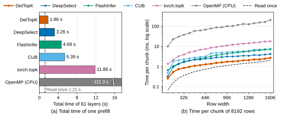
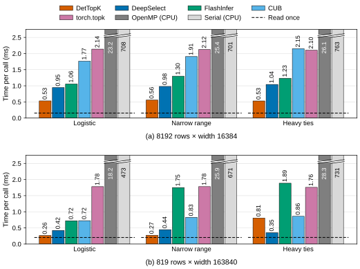
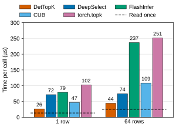

# DetTopK

English | [中文](README_CN.md)

DetTopK is a deterministic batched top-k selection for the GPU, written from scratch in CUDA C++.

- **Input:** a row-major `rows × width` matrix of fp32 scores, a valid length for each row, and k.
- **Output:** a `rows × k` matrix of int32 positions. Row `r` holds the positions of the k highest scores among the first `valid_len[r]` columns of row `r`, in ascending order.

The output depends only on the input: every run and every launch configuration produces the same bytes.

The tuning targets the top-k step of DeepSeek-V3.2's sparse attention on a single NVIDIA H100 (SXM). In that step each query is one row, its valid length is the number of tokens up to it, and k = 2048. Other values of k and other GPUs have not been specifically tuned for.

On an H100, the top-k of one 163,840-token prefill (61 layers) takes 1.86 s with DetTopK, 3.26 s with DeepSelect, 4.68 s with FlashInfer, 5.39 s with CUB and 11.86 s with `torch.topk`.

## Output contract

The interface is [`src/include/dettopk.h`](src/include/dettopk.h).

1. **Set:** exactly the k highest-scoring positions among the valid columns.
2. **Ties:** when positions tie at the k-th score and not all of them fit, the smaller positions win.
3. **Order:** ascending positions. A row with fewer than k valid columns selects all of them and pads with −1.

A NaN in the valid range returns `kNanFound`. Columns beyond the valid length are never read.

## Performance

These results come from one run on a single H100 SXM. The workload uses DeepSeek-V3.2 shapes with k = 2048. "Read once" only reads every score once.

**Prefill:** a 163,840-token prompt in 20 chunks of 8192 queries, 61 layers.



**Shapes and distributions:** the logistic scores are fitted to real indexer output. Narrow range and heavy ties are special cases for radix select. On wide rows with heavy ties DeepSelect is faster, but it does not guarantee that ties go to the smaller position, and on these rows none of its outputs satisfies rule 2.



**Decode:** 1 or 64 rows of width 163,840.



The baselines and which of the three rules of the [output contract](#output-contract) they satisfy:

| Baseline | 1. Set | 2. Ties | 3. Order | Notes |
|---|:-:|:-:|:-:|---|
| DeepSelect | ✓ | ✗ | ✓ | Our `sm_90a` build ([`build_deepselect.sh`](src/bench/build_deepselect.sh)); upstream builds only for Blackwell. Set to output ascending positions; ties are not guaranteed to go to the smaller position |
| FlashInfer 0.7.4 | ✓ | ✓ | ✓ | Deterministic mode, ties to the smaller position. Its documentation only promises a repeatable order; the order was ascending in all our runs |
| CUB | ✓ | ✓ | ✗ | Deterministic batched top-k from the CCCL main branch; output not sorted by position |
| `torch.topk` | ✓ | ✗ | ✗ | `sorted=True`: sorted by score from high to low; repeated runs may differ |
| OpenMP, serial | ✓ | ✓ | ✓ | DetTopK's CPU versions |

## Build and test

```bash
make -C src test       # serial, OpenMP and a host emulation of the kernel; no GPU needed
make -C src test-gpu   # also the real kernel; CUDA_ARCH defaults to sm_90
```

This project has only been tested on `sm_90` and `sm_89` GPUs.

## Usage

```cpp
#include "dettopk.h"

dettopk::Status s = dettopk::topk_host(scores, rows, width, valid_len, k, out);
```

`topk` takes device pointers, `topk_host` host pointers. `topk_serial` and `topk_omp` run on the CPU. All four have the same signature and return the same output. A complete example is in [`src/examples/minimal.cpp`](src/examples/minimal.cpp):

```bash
make -C src example        # CPU only
make -C src example-gpu    # with the GPU
```

To link DetTopK into your own program, compile `src/gpu/topk_gpu.cu` with nvcc as in the [Makefile](src/Makefile) and link it with `src/cpu/*.cpp` and `-lcudart`.

## Usage notes

- The GPU functions use the current device and the default stream.
- They are synchronous and not thread-safe.
- Only fp32 scores are supported.
- There are no Python bindings yet.

## Reproducing the benchmark

On a machine with an H100, CUDA and a Python with torch:

```bash
git clone https://github.com/NVIDIA/cccl.git ~/cccl && git -C ~/cccl checkout c2eb63f
bash src/bench/build_deepselect.sh ~/ext
pip install flashinfer-python==0.7.4

cd src
TAG=h100 CCCL_DIR=~/cccl DEEPSELECT_DIR=~/ext/DeepSelect FLASHINFER=1 bash bench/run_all.sh
python3 bench/summarize.py logs/bench-*-h100-*.csv
```

Each baseline is optional. The options are listed at the top of [`run_all.sh`](src/bench/run_all.sh).

## How it works

Each row is handled by one thread block, in two steps:

1. A radix select over the bits of the scores finds the k-th largest score.
2. A stream compaction then writes the selected positions in order.

A long row is first sampled to choose a cutoff; when the cutoff works, the row is read from global memory only once. When there are only a few rows, a row is split across several blocks. No step depends on the order in which threads finish. [`src/gpu/block_row.h`](src/gpu/block_row.h) documents each step.

## Repository layout

| Path | Lines | Contents |
|---|---:|---|
| `src/include/` | 296 | Public header `dettopk.h` and internal headers |
| `src/gpu/` | 2420 | The CUDA kernel and its host emulation |
| `src/cpu/` | 200 | Serial and OpenMP versions |
| `src/tests/` | 940 | Differential tests |
| `src/examples/` | 70 | Minimal example |
| `src/bench/` | 2370 | Benchmark driver and scripts |

## AI assistance

The development of DetTopK is largely assisted by coding agents in Claude Code.

## License

[MIT](LICENSE) © 2026 Tianyu Bai, Tianshuo Qiao
