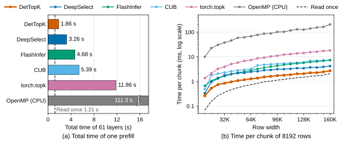
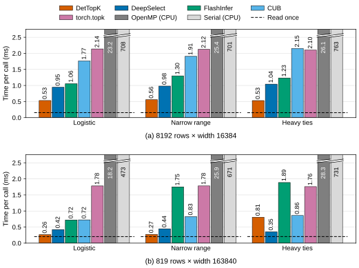
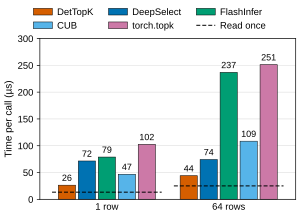

# DetTopK

[English](README.md) | 中文

DetTopK 是一个在 GPU 上运行、结果确定的批量 top-k 选择，用 CUDA C++ 从头实现。

- **输入**：按行存放的 `rows × width` 的 fp32 分数矩阵，每行一个有效长度，以及 $k$。
- **输出**：`rows × k` 的 int32 位置矩阵。第 `r` 行是第 `r` 行前 `valid_len[r]` 列里分数最高的 $k$ 个位置，按升序排列。

输出只由输入决定：每次运行、每种启动配置给出的输出逐字节相同。

调优针对的是 DeepSeek-V3.2 稀疏注意力里的 top-k 这一步，跑在单张 NVIDIA H100（SXM 版）上。在这一步里，每个查询是一行，有效长度是到它为止的 token 数，$k = 2048$。其他的 $k$ 和其他 GPU 没有专门调优。

在 H100 上，一次 163840 个 token 的 prefill（61 层）中 top-k 的总用时：DetTopK 1.86 秒，DeepSelect 3.26 秒，FlashInfer 4.68 秒，CUB 5.39 秒，`torch.topk` 11.86 秒。

## 输出的约定

接口在 [`src/include/dettopk.h`](src/include/dettopk.h)。

1. **集合**：有效范围内分数最高的 $k$ 个位置，不多不少。
2. **并列**：第 $k$ 名的分数上有多个位置并列、名额不够分时，取位置小的。
3. **次序**：位置升序。有效长度不到 $k$ 的行选上全部位置，其余补 −1。

有效范围里有 NaN 时返回 `kNanFound`。有效长度之外的列不读。

## 性能

下面的结果取自单张 H100 SXM 上的一轮评测，负载用 DeepSeek-V3.2 的形状，$k = 2048$。“Read once”只把每个分数读一遍。

**Prefill**：163840 个 token 的提示词分 20 块，每块 8192 个查询，61 层。



**形状和分布**：logistic 分布的参数拟合自真实 indexer 的输出。值域很窄和大量并列是基数选择的特殊情形。在大量并列的宽行上 DeepSelect 更快，但它在并列时不保证位置小的入选，在这些行上的输出都不满足第 2 条约定。



**Decode**：1 行或 64 行，行宽 163840。



各个对照对[输出的约定](#输出的约定)里三条的满足情况：

| 对照 | 1. 集合 | 2. 并列 | 3. 次序 | 备注 |
|---|:-:|:-:|:-:|---|
| DeepSelect | ✓ | ✗ | ✓ | 我们为 `sm_90a` 编译的版本（[`build_deepselect.sh`](src/bench/build_deepselect.sh)），官方只为 Blackwell 编译。设置为按位置升序输出；并列时不保证位置小的入选 |
| FlashInfer 0.7.4 | ✓ | ✓ | ✓ | 确定性模式，并列取位置小的。文档只保证输出的次序可重复，测试中输出都是位置升序 |
| CUB | ✓ | ✓ | ✗ | CCCL 主干里确定性的批量 top-k；输出不按位置排序 |
| `torch.topk` | ✓ | ✗ | ✗ | `sorted=True`，即按分数从高到低排序；重复运行的结果可能不同 |
| OpenMP 版、串行版 | ✓ | ✓ | ✓ | DetTopK 的 CPU 实现 |

## 编译和测试

```bash
make -C src test       # 串行版、OpenMP 版和内核的主机模拟，不需要显卡
make -C src test-gpu   # 再加真实的内核；CUDA_ARCH 默认是 sm_90
```

本项目仅在 `sm_90` 和 `sm_89` 的 GPU 上测试过。

## 用法

```cpp
#include "dettopk.h"

dettopk::Status s = dettopk::topk_host(scores, rows, width, valid_len, k, out);
```

`topk` 收显卡上的指针，`topk_host` 收主机内存的指针，`topk_serial` 和 `topk_omp` 在 CPU 上运行。四个函数的签名相同，输出也相同。完整的例子在 [`src/examples/minimal.cpp`](src/examples/minimal.cpp)：

```bash
make -C src example        # 只用 CPU
make -C src example-gpu    # 加上 GPU
```

要在自己的程序里使用，照 [Makefile](src/Makefile) 用 nvcc 编译 `src/gpu/topk_gpu.cu`，再和 `src/cpu/*.cpp`、`-lcudart` 一起链接。

## 使用须知

- GPU 上的函数用当前的设备和默认流。
- 它们是同步的，不是线程安全的。
- 只支持 fp32 的分数。
- 还没有 Python 绑定。

## 重跑评测

在装有 CUDA 和带 torch 的 Python 的 H100 机器上：

```bash
git clone https://github.com/NVIDIA/cccl.git ~/cccl && git -C ~/cccl checkout c2eb63f
bash src/bench/build_deepselect.sh ~/ext
pip install flashinfer-python==0.7.4

cd src
TAG=h100 CCCL_DIR=~/cccl DEEPSELECT_DIR=~/ext/DeepSelect FLASHINFER=1 bash bench/run_all.sh
python3 bench/summarize.py logs/bench-*-h100-*.csv
```

每个对照都是可选的。选项列在 [`run_all.sh`](src/bench/run_all.sh) 的开头。

## 工作原理

一行交给一个线程块，分两步：

1. 对分数的各位做基数选择（radix select），找出第 $k$ 大的分数。
2. 用流压缩（stream compaction）按次序写出选中的位置。

长行先抽样定一个门槛，门槛合适时整行只从 HBM 读一遍。行数很少时，一行拆给几个线程块。没有哪一步依赖线程完成的先后。每一步的说明在 [`src/gpu/block_row.h`](src/gpu/block_row.h)。

## 程序组成

| 路径 | 行数 | 内容 |
|---|---:|---|
| `src/include/` | 296 | 对外的头文件 `dettopk.h` 和内部头文件 |
| `src/gpu/` | 2420 | CUDA 内核和它的主机模拟 |
| `src/cpu/` | 200 | 串行版和 OpenMP 版 |
| `src/tests/` | 940 | 对拍测试 |
| `src/examples/` | 70 | 最小的调用例子 |
| `src/bench/` | 2370 | 评测驱动和脚本 |

## AI 辅助

DetTopK 的开发在很大程度上借助了 Claude Code 中的编程智能体。

## 许可证

[MIT](LICENSE) © 2026 Tianyu Bai, Tianshuo Qiao
